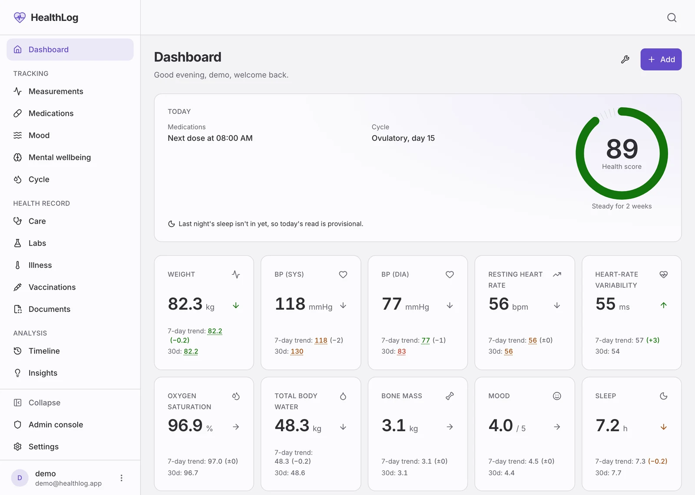

<p align="center">
  
</p>

<h1 align="center">HealthLog</h1>

<p align="center">
  <strong>Self-hosted health tracking that syncs your devices and keeps the data on your own server.</strong>
</p>

<p align="center">
  <a href="LICENSE"></a>
  <a href="https://github.com/MBombeck/HealthLog/releases"></a>
  <a href="https://github.com/MBombeck/HealthLog/actions/workflows/integration.yml"></a>
  <a href="https://apps.apple.com/app/id6769501341"></a>
  <a href="https://testflight.apple.com/join/bucuTBpa"></a>
</p>

<p align="center">
  <a href="https://healthlog.dev">Website</a> |
  <a href="https://demo.healthlog.dev">Live Demo</a> |
  <a href="https://docs.healthlog.dev">Documentation</a> |
  <a href="https://apps.apple.com/app/id6769501341">iOS App Store</a> |
  <a href="https://testflight.apple.com/join/bucuTBpa">iOS TestFlight</a>
</p>

HealthLog is a health record you run yourself. It collects weight, blood pressure, pulse, glucose, sleep, mood, cycle, labs and medications from the devices and apps you already use, puts them on one timeline, and keeps them in a Postgres database on a NAS, homelab or small VPS of yours. It is a web app you can install on any phone or desktop, with a native iPhone and iPad app beside it.

It is for people who track their health over years, often with a condition and several devices, and who would rather not hand that history to a vendor cloud. One `docker compose up` starts it, there is no subscription, and you can export everything.

The [live demo](https://demo.healthlog.dev) is a working install with sample data. Sign in with `demo` / `demo123demo123`.



| At a glance |                                                                                                                 |
| ----------- | --------------------------------------------------------------------------------------------------------------- |
| Hosting     | Your server: two containers, the app and Postgres 18, images for `amd64` and `arm64`                            |
| At rest     | Notes, documents, questionnaire answers, AI texts and every stored credential in AES-256-GCM                    |
| Network     | No telemetry and no HealthLog cloud; each of the three requests the server makes on its own can be switched off |
| Sources     | 9 live connections (8 services plus Apple Health through the iOS app) and 6 file imports                        |
| AI          | Off until configured; your own key, a ChatGPT subscription or a local model                                     |
| Languages   | 10                                                                                                              |
| License     | PolyForm Noncommercial 1.0.0                                                                                    |

<p align="center">
  
  
  
</p>
<p align="center">
  
  
  
</p>

## What it does

| Area            | What is there                                                                                                                                                                                                                                                                                               |
| --------------- | ----------------------------------------------------------------------------------------------------------------------------------------------------------------------------------------------------------------------------------------------------------------------------------------------------------- |
| Vitals          | Weight, blood pressure, pulse, glucose, body composition, SpO₂, respiratory rate, HRV, sleep with a night timeline, workouts, nutrients and energy balance, and metrics you define yourself. Charts use published reference ranges (ESH 2023, ADA 2024) that you can replace with your clinician's targets. |
| Diaries         | Mood, symptoms, illness episodes, a seizure diary, cycle tracking with pregnancy and the weeks after a birth, and validated questionnaires (WHO-5, PHQ-9, GAD-7, Sleep Condition Indicator) in their official wording.                                                                                      |
| Health record   | Labs typed in or read from a scanned report (you confirm every value before it is saved), vaccinations, allergies, family history, conditions, visits and an encrypted document vault.                                                                                                                      |
| Medications     | Weekly, weekday, interval, as-needed and cyclic schedules, a dose window per dose, and one answer per dose on every device. The list groups by category. Reminders go out over APNs, Telegram, ntfy, Web Push, email or a webhook, with one snooze setting for all of them.                                 |
| Sync and import | Withings, WHOOP, Oura, Polar and Strava over OAuth, Garmin, Google Health (Fitbit, Pixel Watch), Nightscout, Apple Health live from the iOS app or as `export.zip`, Health Connect as a file or fetched from a WebDAV or Nextcloud folder, Gadgetbridge, FHIR R4 bundles from patient portals, FIT and CSV. |
| Sharing         | A doctor-report PDF rendered on your server, on demand or filed every month, quarter or year. An emergency card with an offline copy and a QR link. Time-limited clinician share links, a calendar feed for visits and check-ups, a read-only FHIR R4 API and an MCP server.                                |
| Households      | Invites, and managed profiles for someone without a login of their own (a child, a parent) that a guardian keeps, including where that profile's AI comes from.                                                                                                                                             |
| Insights        | Health scores, trends and correlations computed on your server without a model. Optionally a daily briefing and a coach that read your data against guideline ranges, with your own OpenAI or Anthropic key, a ChatGPT subscription, or a local model (Ollama, LM Studio, vLLM).                            |

The app speaks English, German, Spanish, French, Italian, Polish, Korean, Dutch, Brazilian Portuguese and Russian. The [feature tour](https://docs.healthlog.dev/features/) and the [integration guides](https://docs.healthlog.dev/guides/integrations/) have the detail.

### What it is not

HealthLog is not a medical device. It records, charts and exports what you give it, and it does not diagnose, treat or advise treatment; the AI texts say where a value sits, never what you have. It is not a hosted service: there is no HealthLog cloud, no account with us, no ads and no tracking. And it is not built to sell or run a clinic on; the license is noncommercial.

## How it works

Two containers: the Next.js app, which also runs the background jobs, and Postgres 18. Notes, documents, questionnaire answers, AI texts and every stored credential are encrypted with AES-256-GCM before they reach the database. AI is off until someone configures a provider, and a local endpoint keeps those requests on your network. The iOS app talks to the same API as the browser, and your server stays the only database. The [diagrams](docs/diagrams/README.md) show the data flow, the self-hosting topology and the security model.

## Quick start (Docker Compose)

You need Docker with Compose. On the host:

```bash
git clone https://github.com/MBombeck/HealthLog.git && cd HealthLog
cp .env.example .env

# Three secrets, each 32 random bytes as hex:
echo "POSTGRES_PASSWORD=$(openssl rand -hex 32)" >> .env
echo "ENCRYPTION_KEY=$(openssl rand -hex 32)" >> .env
echo "API_TOKEN_HMAC_KEY=$(openssl rand -hex 32)" >> .env

# Only if you open it over plain HTTP (LAN, NAS, Tailscale), or login fails:
echo "SESSION_COOKIE_SECURE=false" >> .env

docker compose up -d
```

Open `http://<host>:3000`. The first account you register becomes the admin, and onboarding walks you through the rest. The image comes pre-built for `amd64` and `arm64` from [GHCR](https://github.com/MBombeck/HealthLog/pkgs/container/healthlog). `curl -s http://localhost:3000/api/version` shows which version is running.

Keep a copy of `ENCRYPTION_KEY` somewhere other than this host. Without it the encrypted data cannot be read, and a database backup does not contain it.

Behind a TLS reverse proxy (Caddy, Traefik, Nginx, Coolify), leave `SESSION_COOKIE_SECURE` unset and set `NEXT_PUBLIC_APP_URL` and `APP_URL` to the public address. The [self-hosting guide](https://docs.healthlog.dev/getting-started/self-host-in-10-minutes/) covers that, and Unraid, Portainer and TrueNAS have [their own pages](https://docs.healthlog.dev/self-hosting/portainer-and-unraid/). Every variable is in the [environment reference](https://docs.healthlog.dev/reference/environment-variables/).

Your data lives in the `postgres-data` volume. The app takes a database dump every night and before every migration into the `backups` volume, and can also send encrypted backups to an S3-compatible bucket. [Backups](https://docs.healthlog.dev/guides/backups/) explains both and how to restore.

## Updating

From 1.49.0 on, releases follow a calendar: a feature release on the first Saturday of every month, fixes on the other Saturdays when there are any. Only a security problem, data loss or a broken install gets a release in between. `:latest` is the newest release; `:edge` is built from every push to `main` (amd64 only) for anyone who wants a fix before its Saturday; `:nightly` is the next month's release branch, built every night from a head whose full test run is green, for trying new features early; it has no way back to an older image without restoring a dump. [Image channels](docs/self-hosting/channels.md) has the compose line for each.

To update, take a backup, run `docker compose pull && docker compose up -d`, and check `/api/version`. Migrations run on start and only go forward. Read the [release notes](https://github.com/MBombeck/HealthLog/releases) first, and see [Updates and deploy](https://docs.healthlog.dev/guides/updates-and-deploy/) for pinning a version and going back. The full rule is in [docs/contributing/release-policy.md](docs/contributing/release-policy.md).

## Privacy and security

HealthLog sends no telemetry. The server makes three requests on its own (an update check, a password breach check and a geolocation lookup for sign-ins), and each can be switched off. Anything else leaving the host is something you set up: a sync, an AI provider, a weather location, the push relay. Measurement values, lab values, medication names and mood scores are stored unencrypted so the server can chart and search them, so the database volume and its backups need the same care as the host. Sign-in works with passkeys and a second factor or through your own OIDC provider, sessions stay on the server, and you get a notification when a passkey, token or device changes. The [security overview](https://docs.healthlog.dev/security/overview/) has the rest, and [SECURITY.md](SECURITY.md) says how to report a vulnerability.

[](https://scorecard.dev/viewer/?uri=github.com/MBombeck/HealthLog) [](https://api.reuse.software/info/github.com/MBombeck/HealthLog) [](SECURITY.md#verifying-a-release)

- Public hosts score A+ on [Mozilla HTTP Observatory](https://developer.mozilla.org/en-US/observatory/analyze?host=demo.healthlog.dev) and [Qualys SSL Labs](https://www.ssllabs.com/ssltest/analyze.html?d=demo.healthlog.dev); the push relay is TLS 1.3 only.
- What the code defends against, and what it leaves to the operator: the [threat model](docs/security/threat-model.md).
- Build provenance: the [push relay](https://github.com/MBombeck/healthlog-push) is built at [SLSA Build Level 3](https://slsa.dev/spec/v1.0/levels#build-l3); HealthLog release images reach it from v1.50.0.
- Checking a release image's signature, provenance and SBOM: [SECURITY.md](SECURITY.md#verifying-a-release). Third-party licences and the policy for new dependencies: [THIRD_PARTY_NOTICES.md](THIRD_PARTY_NOTICES.md).

## iPhone and iPad

The [HealthLog Companion App](https://apps.apple.com/app/id6769501341) is on the App Store, built on the same API as the web app: two-way Apple Health sync, medication reminders you can answer from the lock screen, and an on-device coach on iPhones with Apple Intelligence. The source is at [MBombeck/healthlog-iOS](https://github.com/MBombeck/healthlog-iOS).

App 1.7 is in [TestFlight](https://testflight.apple.com/join/bucuTBpa) and moves to the App Store once it has been tested against server 1.49.0. It adds an iPad layout with a sidebar, a timeline with a lane each for medications, symptoms, seizures, labs and measurements, and Spanish. It also works with the optional push relay. Apple only delivers pushes to the App Store app when they are signed with the publisher's key, which a self-hosted server does not have. The relay fills that gap: your server seals each notification for one device, the relay passes it to Apple and cannot read it. It is run by the project on donations, free for private and household use, off until an admin turns it on, and open source at [MBombeck/healthlog-push](https://github.com/MBombeck/healthlog-push). The [push relay guide](https://docs.healthlog.dev/guides/push-relay/) and the relay's [privacy notice](https://push.healthlog.dev/privacy) list what it sees.

The App Store price is there to cover Apple's yearly developer fee. TestFlight is free and gets new builds first, and you can build the app from source.

## Help and contributing

Questions go to [Discussions](https://github.com/MBombeck/HealthLog/discussions), bugs to [Issues](https://github.com/MBombeck/HealthLog/issues). [Reporting a problem](https://docs.healthlog.dev/support/) shows how to copy the redacted support info that makes a report useful. Pull requests are welcome; [CONTRIBUTING.md](CONTRIBUTING.md) covers the setup, the branch model and [translations](CONTRIBUTING.md#translations). The API contract for clients is [`docs/api/openapi.yaml`](docs/api/openapi.yaml).

Anything that does not fit a public thread can go to `hello@healthlog.dev`; security problems go to `security@healthlog.dev` as described in [SECURITY.md](SECURITY.md).

If HealthLog is useful to you, [GitHub Sponsors](https://github.com/sponsors/MBombeck) and [Buy Me a Coffee](https://buymeacoffee.com/mbombeck) pay for the servers, the push relay and the Apple developer account.

## Thanks

HealthLog started as something I built for myself. That it has turned into a project other people use, care about and help shape still surprises me, and I am grateful for every part of it.

Thank you to everyone who sent code that shipped: [@TimonBed](https://github.com/TimonBed), [@Antiheld86](https://github.com/Antiheld86), [@BernhardBuckel](https://github.com/BernhardBuckel), [@balajiv113](https://github.com/balajiv113), [@aucun6352](https://github.com/aucun6352), [@mathewcsims](https://github.com/mathewcsims), [@muhdusama](https://github.com/muhdusama) and [@ferges123](https://github.com/ferges123).

Thank you to everyone who opened an issue, asked a question in the discussions or wrote me an email, and especially to [@lutzkind](https://github.com/lutzkind), [@HercoGC](https://github.com/HercoGC), [@mills1975](https://github.com/mills1975), [@sreeramachandramurthy](https://github.com/sreeramachandramurthy), [@CritLoren](https://github.com/CritLoren), [@mbreitkreuz](https://github.com/mbreitkreuz), [@k-nacion](https://github.com/k-nacion), [@NebuPookins](https://github.com/NebuPookins), [@Nazza01](https://github.com/Nazza01), [@Cnote43](https://github.com/Cnote43) and [@juliaanvaneijndt](https://github.com/juliaanvaneijndt), whose reports shaped HealthLog again and again. Most of what got better in the last months started with someone describing what went wrong for them, often with a log, a screenshot and a second try when the first fix was not enough.

And thank you to everyone who supported the project with a coffee or by buying the iPhone app. I don't name anyone here, but I read every message that comes with it. It tells me that HealthLog is worth the evenings.

<a href="https://github.com/MBombeck/HealthLog/graphs/contributors">
  
</a>

Every merged pull request keeps its author's name on the commit, so the [contributor graph](https://github.com/MBombeck/HealthLog/graphs/contributors) is the full list. Release notes name the people whose work is in that release, including anyone who found the defect without sending the fix.

## License

HealthLog is licensed under the [PolyForm Noncommercial License 1.0.0](LICENSE): free to use, self-host and modify for noncommercial purposes. Commercial use needs a separate agreement; open an issue or get in touch through [healthlog.dev](https://healthlog.dev). Releases up to and including v1.15.18 were published under AGPL-3.0 and remain available under that license. The push relay is a separate project under Apache-2.0.

---

<p align="center">
  <a href="https://healthlog.dev">healthlog.dev</a> |
  <a href="https://demo.healthlog.dev">Live Demo</a> |
  <a href="https://docs.healthlog.dev">Docs</a> |
  <a href="https://apps.apple.com/app/id6769501341">iOS App Store</a> |
  <a href="https://testflight.apple.com/join/bucuTBpa">iOS TestFlight</a> |
  <a href="https://github.com/sponsors/MBombeck">GitHub Sponsors</a> |
  <a href="https://buymeacoffee.com/mbombeck">Buy Me a Coffee</a>
</p>
